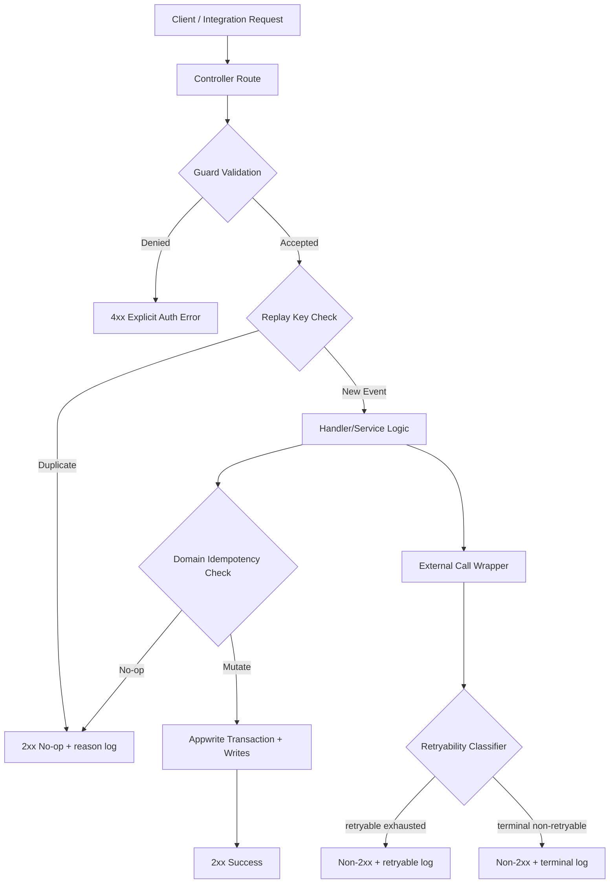

# Phase 1: Security and Integration Contract Hardening - Research

**Researched:** 2026-05-29
**Domain:** NestJS API security boundaries, webhook contract hardening, integration reliability
**Confidence:** HIGH

<user_constraints>
## User Constraints (from CONTEXT.md)

### Locked Decisions
- **D-01:** Protect all user-reachable mutation endpoints with `AppwriteSessionGuard` plus role policy where required; avoid public mutation routes without guard coverage.
- **D-02:** Derive actor identity from authenticated context (`request.user`) for protected mutations. Body-provided identity fields (for example `userId`) are not trusted as authority.
- **D-03:** Keep machine-only mutation paths explicit and isolated behind system/webhook guards rather than sharing public payload contracts.

- **D-04:** Validate inbound webhook authenticity with canonical raw-body signature/secret verification and timing-safe comparisons.
- **D-05:** Add replay/duplicate protection at ingress using deterministic event keys persisted before side effects; duplicate deliveries must short-circuit safely.
- **D-06:** Signature validation must be resilient to deployment URL drift by using stable canonical message construction for signing input.

- **D-07:** Return non-2xx status for retryable or internal processing failures in webhook/sync handlers.
- **D-08:** Return 2xx only for intentional no-op outcomes (unsupported event type, already-processed/idempotent duplicate) with explicit reason logging.
- **D-09:** Preserve existing domain idempotency checks (`z_entries_read` anti-spam state, checksum-based IGDB upsert short-circuit) and run them before costly side effects.

- **D-10:** Outbound calls to IGDB/Twitch and other critical providers must use bounded timeout and capped retries with jitter for retryable failures (`429`/`5xx`/network timeouts).
- **D-11:** Non-retryable failures (`4xx` contract issues, auth misconfiguration) fail fast and return observable error status to upstream callers.
- **D-12:** Classify and log integration failures with enough structure (provider, operation, retryability, terminal status) to support alerts and safe retries.

### the agent's Discretion
- Exact timeout and retry values per integration can be tuned during planning (for example per endpoint risk and provider quota), as long as bounds and retry caps are explicit and testable.
- Storage implementation for replay keys is flexible (dedicated table or constrained log table) if it guarantees deterministic dedupe and bounded retention.

### Deferred Ideas (OUT OF SCOPE)
None - discussion stayed within phase scope.
</user_constraints>

<phase_requirements>
## Phase Requirements

| ID | Description | Research Support |
|----|-------------|------------------|
| SECU-01 | Protected mutation endpoints require authn/authz | Guard coverage audit, route-tier ownership map, explicit controller/guard hardening plan |
| SECU-02 | Mutation identity derived from authenticated context | Current zcoins body-identity gap, contract split recommendation (user vs machine route) |
| SECU-03 | Integration routes enforce validated secret/signature + replay protection | Webhook guard hardening, timing-safe compare, ingress dedupe key persistence guidance |
| SECU-04 | Explicit authorization denial semantics | Guard exception behavior and endpoint response semantics recommendations |
| RELY-01 | Webhook ingestion idempotent for duplicate deliveries | Existing domain idempotency inventory + ingress idempotency layer recommendation |
| RELY-02 | Webhook/sync failures return failure status for retry/alerting | Current 200-on-failure gaps and status contract matrix |
| RELY-04 | External integrations use bounded retries/timeouts with observable failures | IGDB/Twitch request wrapper strategy with timeout, retry policy, and failure classification |
</phase_requirements>

## Project Constraints (from copilot-instructions.md)

- Keep current NestJS + Appwrite architecture; avoid platform migration. [CITED: ./copilot-instructions.md]
- Prioritize high-leverage, short-horizon changes (2-4 weeks). [CITED: ./copilot-instructions.md]
- Preserve existing API consumers and webhook contracts where possible. [CITED: ./copilot-instructions.md]
- Keep sync/webhook/rewards changes rollback-friendly. [CITED: ./copilot-instructions.md]
- Preserve transactional correctness in mutating Appwrite-backed flows. [CITED: ./copilot-instructions.md]

## Summary

Phase 1 should be planned as boundary hardening, not domain rewrite: enforce guard coverage and actor identity on user mutations, enforce deterministic ingress authenticity/replay defenses, and normalize webhook/sync failure semantics so retryable failures surface as non-2xx. This aligns directly with the locked decisions and the requirement set (SECU-01..04, RELY-01..02, RELY-04). [VERIFIED: codebase grep]

Current code already contains useful primitives: `AppwriteSessionGuard` with role metadata, webhook raw-body support in Nest bootstrap, `z_entries_read` anti-spam/idempotency state, and IGDB checksum short-circuit upsert behavior. However, there are contract breaches that must be addressed in planning: public zcoins mutation endpoints accept body `userId`, webhook guards do not perform timing-safe comparison/replay dedupe, and webhook handlers currently return `200 OK` even on internal failures. [VERIFIED: codebase grep]

External integration reliability is currently under-specified in code paths: IGDB/Twitch calls use `fetch` without timeout/retry policy and without retryability classification. The plan should introduce a shared outbound policy wrapper using built-in Node/Nest primitives (`AbortSignal.timeout`, bounded retry with jitter, structured logs), preserving existing provider clients and avoiding new framework migrations. [CITED: https://nodejs.org/api/globals.html#static-method-abortsignaltimeoutdelay] [VERIFIED: codebase grep]

**Primary recommendation:** Implement a thin cross-cutting hardening layer (guard + contract + retry wrappers) around existing controllers/services rather than module re-architecture. [VERIFIED: codebase grep]

## Architectural Responsibility Map

| Capability | Primary Tier | Secondary Tier | Rationale |
|------------|-------------|----------------|-----------|
| User mutation authn/authz (`zcoins` writes) | API / Backend | Database / Storage | Auth context and policy are route concerns; storage only enforces persistence. [VERIFIED: codebase grep] |
| Actor identity derivation for critical mutations | API / Backend | — | Identity must come from authenticated request context before service invocation. [CITED: https://docs.nestjs.com/guards] |
| Ingress signature/secret verification | API / Backend | — | Headers/raw body are validated at controller/guard boundary. [CITED: https://docs.nestjs.com/faq/raw-body] [CITED: https://appwrite.io/docs/advanced/platform/webhooks] |
| Replay/duplicate ingress defense | API / Backend | Database / Storage | Deterministic event keys require persistence to survive process restarts and multi-instance operation. [ASSUMED] |
| Domain idempotency (entry/game upsert) | API / Backend | Database / Storage | Business-level duplicate suppression depends on read/write state (`z_entries_read`, checksums). [VERIFIED: codebase grep] |
| Webhook failure semantics for retryability | API / Backend | — | HTTP response class controls sender retry behavior. [CITED: https://developer.mozilla.org/en-US/docs/Web/HTTP/Status] |
| IGDB/Twitch timeout/retry/failure classification | API / Backend | — | Outbound resiliency belongs in integration adapter/service boundary. [VERIFIED: codebase grep] |

## Current-State Findings and Gaps

| Area | Current State | Gap | Req IDs |
|------|---------------|-----|---------|
| Mutation guard coverage | `zcoins` mutation routes (`POST /zcoins/input`, `POST /zcoins/output`) have no guard. [VERIFIED: codebase grep] | User-reachable mutation routes are currently callable without session/role checks. [VERIFIED: codebase grep] | SECU-01 |
| Actor identity source | `zcoins` controller accepts body `userId` and forwards directly to service. [VERIFIED: codebase grep] | Critical mutation authority comes from client payload instead of authenticated principal. [VERIFIED: codebase grep] | SECU-02 |
| Appwrite webhook signature compare | `AppwriteWebhookGuard` computes HMAC-SHA1 but compares as plain string equality. [VERIFIED: codebase grep] | Missing timing-safe equality at signature check. [CITED: https://nodejs.org/api/crypto.html#cryptotimingsafeequala-b] | SECU-03 |
| Appwrite webhook signature canonicalization | Signature message includes `APP_URL + /webhook/{endpoint} + rawBody`. [VERIFIED: codebase grep] | Sensitive to deployment URL drift if canonical URL assumptions differ by environment/proxy. [ASSUMED] | SECU-03 |
| IGDB webhook authenticity | `IGDBGuard` validates plain `X-Secret` equality only. [VERIFIED: codebase grep] | No timing-safe compare and no replay key checks at ingress. [VERIFIED: codebase grep] | SECU-03 |
| Replay defense | No ingress replay store/check found in webhook guards/controller. [VERIFIED: codebase grep] | Duplicate deliveries can still execute handler path before domain-level conflicts in some paths. [VERIFIED: codebase grep] | SECU-03, RELY-01 |
| Domain idempotency | `zetho.handler` uses deterministic `z_entries_read` key and anti-spam state; IGDB upsert short-circuits when checksum unchanged. [VERIFIED: codebase grep] | Good existing logic should be preserved and moved earlier in execution path where possible. [VERIFIED: codebase grep] | RELY-01 |
| Webhook failure semantics | `IGDBHandler` throws `HttpException(..., HttpStatus.OK)` on errors; `ZethoHandler` returns `{ success:false }` from catch, resulting in 200. [VERIFIED: codebase grep] | Retryable/internal failures are masked as success responses. [VERIFIED: codebase grep] | RELY-02 |
| Unsupported/no-op semantics | Unsupported Appwrite events return `HttpStatus.OK` (intentional no-op). [VERIFIED: codebase grep] | Need explicit reason logging taxonomy to distinguish expected no-op from hidden errors. [ASSUMED] | RELY-02 |
| Outbound resilience | IGDB/Twitch fetches have no timeout or retry wrapper. [VERIFIED: codebase grep] | Missing bounded retries/timeouts + structured retryability classification. [VERIFIED: codebase grep] | RELY-04 |
| Test coverage | Only root controller unit/e2e smoke tests detected; no webhook/guard/zcoins hardening tests. [VERIFIED: codebase grep] | High-risk contract changes are currently unprotected by targeted tests. [VERIFIED: codebase grep] | QUAL-01 (future), supports all Phase 1 reqs |

## Implementation Options and Recommended Direction

### Option A (Recommended): Route-Split + Boundary Hardening in Place

**What:** Keep existing module layout; harden guards/controllers/services with explicit user-vs-machine mutation contracts and shared outbound retry helper. [VERIFIED: codebase grep]

**Why recommended:** Lowest migration risk, direct fit to locked decisions D-01..D-12, and preserves existing API/module composition under timeline constraints. [CITED: ./copilot-instructions.md]

**Tradeoffs:** Requires careful route compatibility handling and migration path for current clients using body `userId`. [ASSUMED]

### Option B: Centralized Security Middleware Layer

**What:** Push most checks into global middleware/interceptors.

**Why not preferred:** Guards are the Nest-standard authorization boundary with handler-aware metadata context; middleware lacks route metadata awareness. [CITED: https://docs.nestjs.com/guards]

### Recommended Direction Details

1. Harden `zcoins` mutations with `AppwriteSessionGuard` + role check for user routes, deriving `userId` from `request.user`. [VERIFIED: codebase grep]
2. Keep explicit machine-only mutation paths behind `SystemApiKeyGuard`/webhook guards (separate route contract). [VERIFIED: codebase grep]
3. Add ingress replay key persistence and short-circuit responses before expensive side effects. [ASSUMED]
4. Normalize webhook/sync response semantics: 2xx for intentional no-op/idempotent duplicate, non-2xx for retryable/internal failures. [CITED: https://developer.mozilla.org/en-US/docs/Web/HTTP/Status]
5. Wrap IGDB/Twitch outbound calls in timeout + capped retry + retryability classification policy. [CITED: https://nodejs.org/api/globals.html#static-method-abortsignaltimeoutdelay] [VERIFIED: codebase grep]

## Risks and Tradeoffs

| Risk | Impact | Mitigation |
|------|--------|------------|
| Breaking existing clients that send body `userId` to zcoins routes | Medium | Introduce versioned/parallel route contract and migration window with deprecation logs. [ASSUMED] |
| Over-retrying non-retryable upstream failures | Medium | Explicit classifier: retry only network timeout, 429, and 5xx; fail fast on 4xx contract/auth errors. [CITED: https://developer.mozilla.org/en-US/docs/Web/HTTP/Reference/Status/429] |
| Replay key table growth | Medium | Bounded retention policy with TTL/cleanup job and deterministic keying. [ASSUMED] |
| False duplicate suppression | Low-Medium | Canonical key schema includes provider + operation + source event ID/hash; include collision tests. [ASSUMED] |
| Operational confusion from mixed success semantics | Medium | Structured logging schema with reason codes (`NOOP_UNSUPPORTED`, `NOOP_DUPLICATE`, `RETRYABLE_ERROR`, `TERMINAL_ERROR`). [ASSUMED] |

## Standard Stack

### Core
| Library | Version | Purpose | Why Standard |
|---------|---------|---------|--------------|
| `@nestjs/common` | 11.1.24 (npm latest), project uses `^11.0.1` | Guards, exceptions, controller boundary enforcement | Native framework primitive for route authorization and explicit denial semantics. [VERIFIED: npm registry] [CITED: https://docs.nestjs.com/guards] |
| `node-appwrite` | 25.2.0 (npm latest), project uses `^22.1.0` | Appwrite data/auth/webhook ecosystem integration | Existing integration backbone; avoids introducing new persistence/SDK surface in Phase 1. [VERIFIED: npm registry] [VERIFIED: codebase grep] |
| Node `crypto`/`fetch`/`AbortSignal` | Node runtime v24.15.0 available | Signature verification, timing-safe compare, timeout controls | Built-in primitives eliminate dependency expansion for security-critical path. [VERIFIED: codebase grep] [CITED: https://nodejs.org/api/crypto.html#cryptotimingsafeequala-b] [CITED: https://nodejs.org/api/globals.html#static-method-abortsignaltimeoutdelay] |

### Supporting
| Library | Version | Purpose | When to Use |
|---------|---------|---------|-------------|
| `class-validator` | 0.15.1 (npm latest), project uses `^0.15.1` | DTO validation for explicit contract errors | Apply to mutation/webhook DTOs where malformed payloads must fail predictably. [VERIFIED: npm registry] |
| `valibot` | 1.4.1 (npm latest), project uses `^1.2.0` | Existing custom validation pipe compatibility | Reuse only where module already uses Valibot; avoid introducing dual validation strategies in new paths. [VERIFIED: npm registry] [VERIFIED: codebase grep] |

### Alternatives Considered
| Instead of | Could Use | Tradeoff |
|------------|-----------|----------|
| Built-in `fetch` + `AbortSignal` + custom retry helper | `axios` + retry plugin | Adds dependency surface and behavior divergence without clear Phase 1 necessity. [ASSUMED] |
| Existing guard-based boundary checks | Middleware-only checks | Middleware lacks route metadata context needed for policy+roles. [CITED: https://docs.nestjs.com/guards] |

**Installation:**
```bash
# No new packages required for Phase 1 recommended direction.
```

## Package Legitimacy Audit

No new external package installation is required by the recommended direction for this phase. [VERIFIED: codebase grep]

## Architecture Patterns

### System Architecture Diagram


### Recommended Project Structure
```text
src/
├── common/
│   ├── guards/                     # strengthened auth/signature guards
│   └── integration/                # shared retry/timeout policy helper
├── modules/
│   ├── webhook/
│   │   ├── webhook.controller.ts   # normalized status contract
│   │   ├── handlers/               # preserve domain idempotency logic
│   │   └── replay/                 # ingress replay key service/repository
│   ├── zcoins/
│   │   └── zcoins.controller.ts    # session-derived actor identity
│   └── igdb/
│       └── igdb.service.ts         # bounded timeout/retry wrapper usage
└── test/
    └── security-integration/       # new phase-specific e2e/integration tests
```

### Pattern 1: Guard-First Authorization + Role Metadata
**What:** Enforce access at route boundary using `@UseGuards` and handler metadata.
**When to use:** All user-reachable mutation endpoints.
**Example:**
```typescript
// Source: https://docs.nestjs.com/guards
@Post('mutation')
@UseGuards(AppwriteSessionGuard)
@Roles(['user'])
mutate(@Req() req: any, @Body() dto: MutationDto) {
  const user = req.user; // authority source
  return this.service.mutate(user.$id, dto);
}
```

### Pattern 2: Raw-Body Signature Verification with Timing-Safe Compare
**What:** Verify webhook authenticity using raw body + canonical message + timing-safe compare.
**When to use:** All signed ingress routes.
**Example:**
```typescript
// Source: https://appwrite.io/docs/advanced/platform/webhooks
// Source: https://nodejs.org/api/crypto.html#cryptotimingsafeequala-b
const generated = crypto.createHmac('sha1', secret).update(url + payload).digest('base64');
const ok = crypto.timingSafeEqual(Buffer.from(generated), Buffer.from(signature));
if (!ok) throw new UnauthorizedException('Invalid signature');
```

### Pattern 3: Bounded Outbound Retry + Timeout
**What:** Use timeout + capped retries for transient failures only.
**When to use:** IGDB/Twitch and other critical provider calls.
**Example:**
```typescript
// Source: https://nodejs.org/api/globals.html#static-method-abortsignaltimeoutdelay
const signal = AbortSignal.timeout(5000);
const res = await fetch(url, { method: 'POST', headers, body, signal });
if (res.status === 429 || res.status >= 500) {
  // bounded retry with jitter
}
```

### Anti-Patterns to Avoid
- **Body-authoritative identity:** Treating `body.userId` as trusted mutation authority on user routes. [VERIFIED: codebase grep]
- **200-on-failure webhook contract:** Returning `HttpStatus.OK` for internal processing failure paths. [VERIFIED: codebase grep]
- **String-equality signature checks:** Comparing secrets/signatures without timing-safe compare. [VERIFIED: codebase grep]
- **Unbounded external calls:** Outbound fetches without timeout and retry caps. [VERIFIED: codebase grep]

## Don't Hand-Roll

| Problem | Don't Build | Use Instead | Why |
|---------|-------------|-------------|-----|
| Authorization boundary | Ad-hoc per-method if/else auth checks | Nest guards + role metadata | Consistent enforcement and explicit denial semantics at framework boundary. [CITED: https://docs.nestjs.com/guards] |
| Signature compare | Plain string equality on secret/signature | `crypto.timingSafeEqual` | Reduces timing side-channel risk in comparison primitive. [CITED: https://nodejs.org/api/crypto.html#cryptotimingsafeequala-b] |
| Raw payload reconstruction | Re-serialize parsed body for signature input | `rawBody` request buffer from Nest setup | Signature verification should use original bytes. [CITED: https://docs.nestjs.com/faq/raw-body] |
| Retry semantics | Per-call bespoke retry logic | Shared retry policy wrapper with classifier | Prevents inconsistent behavior and retry storms. [ASSUMED] |

**Key insight:** Keep Phase 1 implementation as policy centralization around existing domain flows, not custom protocol redesign. [VERIFIED: codebase grep]

## Common Pitfalls

### Pitfall 1: Conflating Authn and Actor Authority
**What goes wrong:** Endpoint is authenticated but still mutates for arbitrary body `userId`.
**Why it happens:** Guard presence is treated as sufficient without actor-binding checks.
**How to avoid:** Derive actor from `request.user` in controller boundary; reject or ignore body identity on protected routes.
**Warning signs:** Mutation routes with `@Body('userId')` and no `@UseGuards(AppwriteSessionGuard)`. [VERIFIED: codebase grep]

### Pitfall 2: Retry Blindness Through 200-on-Error Responses
**What goes wrong:** Upstream sender treats failed processing as successful delivery.
**Why it happens:** Handler catches errors and returns `HttpStatus.OK` or `{ success:false }` payload with 200.
**How to avoid:** Use explicit non-2xx for retryable/internal errors and 2xx only for intentional no-op/idempotent duplicates.
**Warning signs:** `HttpException(..., HttpStatus.OK)` in catch blocks for failure paths. [VERIFIED: codebase grep]

### Pitfall 3: Signature Checks That Are Correct but Fragile
**What goes wrong:** Valid webhooks intermittently fail after URL/infra changes.
**Why it happens:** Canonical string input depends on deployment URL assumptions.
**How to avoid:** Stabilize canonical URL/source config and test signatures under proxied/base-url variants.
**Warning signs:** Signature verification depends on mutable `APP_URL` without environment invariants. [VERIFIED: codebase grep]

### Pitfall 4: Domain Idempotency Without Ingress Replay Gate
**What goes wrong:** Duplicate events still consume resources or trigger noisy failures.
**Why it happens:** Duplicate suppression occurs late in handler/domain layer only.
**How to avoid:** Persist replay key at ingress before side effects; short-circuit duplicates as no-op success.
**Warning signs:** No replay key store/check in guard/controller ingress path. [VERIFIED: codebase grep]

## Code Examples

### Explicit denial semantics from guard
```typescript
// Source: https://docs.nestjs.com/guards
if (!hasRequiredRoles) {
  throw new ForbiddenException('Insufficient role');
}
```

### Appwrite-style signature verification pattern
```typescript
// Source: https://appwrite.io/docs/advanced/platform/webhooks
const generated = crypto.createHmac('sha1', signatureKey).update(webhookUrl + payload).digest('base64');
```

### Retryability classification scaffold
```typescript
// Source: https://developer.mozilla.org/en-US/docs/Web/HTTP/Status
const retryable = status === 429 || status >= 500 || error.name === 'TimeoutError';
```

## State of the Art

| Old Approach | Current Approach | When Changed | Impact |
|--------------|------------------|--------------|--------|
| Middleware-centric authorization assumptions | Guard + metadata-aware authorization boundaries | Established Nest pattern | Cleaner policy enforcement and explicit route-level semantics. [CITED: https://docs.nestjs.com/guards] |
| Parsed-body webhook validation | Raw-body-based signature validation | Current Nest/Appwrite docs | Prevents signature mismatches due to body mutation/re-serialization. [CITED: https://docs.nestjs.com/faq/raw-body] [CITED: https://appwrite.io/docs/advanced/platform/webhooks] |
| No timeout control in fetch | `AbortSignal.timeout` for bounded calls | Node 16.14+ / 17.3+ support | Enables deterministic failure windows for retries and observability. [CITED: https://nodejs.org/api/globals.html#static-method-abortsignaltimeoutdelay] |

**Deprecated/outdated:**
- Treating `401` and `403` interchangeably for authorization failures is semantically imprecise; prefer explicit unauthorized vs forbidden semantics. [CITED: https://developer.mozilla.org/en-US/docs/Web/HTTP/Status/401] [CITED: https://developer.mozilla.org/en-US/docs/Web/HTTP/Status/403]

## Assumptions Log

| # | Claim | Section | Risk if Wrong |
|---|-------|---------|---------------|
| A1 | Replay key persistence should be durable across instances and process restarts. | Architectural Responsibility Map / Pitfalls | Duplicate processing could still occur in distributed deployment. |
| A2 | Existing zcoins clients may rely on body `userId` contract and need migration path. | Risks and Tradeoffs | Breaking change for existing clients/integrations. |
| A3 | Structured reason-code taxonomy (`NOOP_*`, `RETRYABLE_*`) is acceptable without conflicting log schema constraints. | Risks and Tradeoffs | Operational dashboards/alerts could fragment if schema conflicts. |

## Open Questions

1. **Replay key retention window and storage target**
   - What we know: ingress replay gate is required by decision D-05.
   - What's unclear: retention duration and preferred table/index strategy in Appwrite.
   - Recommendation: decide explicit TTL (for example 7-30 days) during plan creation and add cleanup task.

2. **Public zcoins mutation backward compatibility**
   - What we know: current contract accepts body `userId` on public endpoints.
   - What's unclear: whether external clients currently use this directly.
   - Recommendation: include compatibility checkpoint and rollout strategy (parallel route or temporary compatibility adapter).

3. **Canonical URL strategy for Appwrite signature input**
   - What we know: verification includes URL + raw body.
   - What's unclear: source-of-truth URL in multi-env/proxy deployment.
   - Recommendation: lock canonical webhook base URL config and add environment parity test cases.

## Environment Availability

| Dependency | Required By | Available | Version | Fallback |
|------------|------------|-----------|---------|----------|
| Node.js | Nest API runtime, crypto/fetch timeout features | ✓ | v24.15.0 | — |
| pnpm | Workspace scripts and test execution | ✓ | 11.1.2 | npm scripts runnable via npm where needed |
| npm | Registry verification and package tooling | ✓ | 11.14.1 | — |
| curl | Integration/manual endpoint verification | ✓ | 8.20.0 | Node fetch scripts |
| Docker | Optional local dependency sandboxing | ✓ | 29.5.2 | Native local runtime |
| Python3 | Optional tooling (slopcheck, scripts) | ✓ | 3.14.4 | — |

**Missing dependencies with no fallback:**
- None identified. [VERIFIED: local environment audit]

**Missing dependencies with fallback:**
- None identified. [VERIFIED: local environment audit]

## Verification Strategy Suggestions (for Planner)

1. Add guard/authz tests for zcoins mutation routes:
   - unauthenticated -> 401
   - authenticated without required role -> 403 (or policy-specific denial)
   - authenticated -> mutation uses `request.user` identity, ignores body `userId`
2. Add webhook authenticity tests:
   - valid signature/secret accepted
   - invalid signature/secret rejected
   - timing-safe compare path exercised for mismatched lengths
3. Add replay/idempotency tests:
   - duplicate ingress event key returns 2xx no-op and does not mutate state twice
   - existing domain idempotency (`z_entries_read`, checksum skip) still preserved
4. Add failure semantics tests:
   - internal processing failure from webhook handler yields non-2xx
   - unsupported event/duplicate no-op yields 2xx with reason code
5. Add outbound resilience tests for IGDB/Twitch wrapper:
   - timeout triggers retry path
   - 429/5xx retry up to cap with jitter
   - terminal 4xx fails fast without retry

Suggested command shape (once tests exist):
```bash
pnpm test -- webhook
pnpm test -- zcoins
pnpm test:e2e
```

## Security Domain

### Applicable ASVS Categories

| ASVS Category | Applies | Standard Control |
|---------------|---------|-----------------|
| V2 Authentication | yes | `AppwriteSessionGuard` for protected user mutation routes. [VERIFIED: codebase grep] |
| V3 Session Management | yes | JWT/session validation in session guard using Appwrite account context. [VERIFIED: codebase grep] |
| V4 Access Control | yes | Role metadata (`@Roles`) + guard enforcement at handler boundary. [VERIFIED: codebase grep] |
| V5 Input Validation | yes | DTO + validation pipe patterns where applied; must be expanded to hardened mutation/webhook paths. [VERIFIED: codebase grep] |
| V6 Cryptography | yes | HMAC-SHA1 signature verification with timing-safe comparison primitive. [CITED: https://appwrite.io/docs/advanced/platform/webhooks] [CITED: https://nodejs.org/api/crypto.html#cryptotimingsafeequala-b] |

### Known Threat Patterns for NestJS + Appwrite + Webhook Integrations

| Pattern | STRIDE | Standard Mitigation |
|---------|--------|---------------------|
| Body-identity spoofing on mutation routes | Spoofing / Elevation of Privilege | Bind actor to authenticated principal (`request.user`) and ignore body authority fields. |
| Forged webhook requests | Spoofing / Tampering | Signature/secret verification using raw body + timing-safe compare. |
| Webhook replay | Replay (Tampering/Repudiation) | Deterministic ingress replay key persistence + duplicate short-circuit. |
| Silent failure masking (200 on error) | Repudiation / Availability | Non-2xx on retryable/internal failures + structured reason logging. |
| Upstream instability (429/5xx/timeouts) | Availability | Bounded timeout + capped retries + retryability classifier. |

## Sources

### Primary (HIGH confidence)
- Codebase inspection (`src/common/guards/*.ts`, `src/modules/webhook/**/*.ts`, `src/modules/zcoins/*.ts`, `src/modules/igdb/*.ts`, `src/main.ts`) - current-state findings and gaps. [VERIFIED: codebase grep]
- NestJS Guards docs - authorization boundary behavior and guard semantics: https://docs.nestjs.com/guards
- NestJS Raw Body docs - webhook verification raw payload pattern: https://docs.nestjs.com/faq/raw-body
- Appwrite Webhooks docs - headers/signature verification pattern: https://appwrite.io/docs/advanced/platform/webhooks
- Node crypto docs - timing-safe compare: https://nodejs.org/api/crypto.html#cryptotimingsafeequala-b
- Node globals docs - `AbortSignal.timeout`: https://nodejs.org/api/globals.html#static-method-abortsignaltimeoutdelay
- IGDB docs - auth headers, rate limits, webhook secret header behavior: https://api-docs.igdb.com/
- Twitch auth docs - client credentials token flow: https://dev.twitch.tv/docs/authentication/getting-tokens-oauth/#client-credentials-grant-flow
- npm registry checks (`npm view`) for versions: `@nestjs/common`, `node-appwrite`, `class-validator`, `valibot`. [VERIFIED: npm registry]

### Secondary (MEDIUM confidence)
- MDN HTTP status reference used for retry/failure semantic mapping: https://developer.mozilla.org/en-US/docs/Web/HTTP/Status

### Tertiary (LOW confidence)
- None.

## Metadata

**Confidence breakdown:**
- Standard stack: HIGH - validated against package.json and npm registry.
- Architecture: HIGH - derived from direct codebase inspection and locked phase decisions.
- Pitfalls: HIGH - directly evidenced in current controllers/guards/handlers.

**Research date:** 2026-05-29
**Valid until:** 2026-06-28
